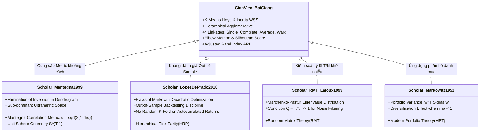

# TỔNG QUAN HỆ THỐNG KIẾN THỨC BỘ BÀI GIẢNG 9 TUẦN & TÀI LIỆU HỌC THUẬT SCHOLAR
## ÁP DỤNG VÀO ĐỀ TÀI: PHÂN NHÓM CỔ PHIẾU VN100 PHỤC VỤ ĐA DẠNG HÓA DANH MỤC ĐẦU TƯ

> **Học phần:** Học máy (Machine Learning) – Khóa K22 KHMT, Trường CNTT&TT (ICTU)  
> **Giảng viên biên soạn:** Nguyễn Tuấn Anh  
> **Nguồn tài liệu nội bộ:** `machine-learning/` (Bài 1 – Bài 9, Giáo trình 2026, Tiêu chí chấm thi)  
> **Nguồn học thuật quốc tế:** Google Scholar (Mantegna 1999, Markowitz 1952, López de Prado 2016/2018, Laloux 1999, Rousseeuw 1987)

---

## 1. TỔNG HỢP KIẾN TRÚC VÀ QUY ƯỚC CHUẨN CỦA BỘ BÀI GIẢNG

### 1.1. Cấu trúc 9 bài giảng và mối liên hệ với đề tài

- **Bài 1 (`lesson_01`):** Khái niệm học máy, phân loại bài toán (Học không giám sát Unsupervised Learning), phát biểu bài toán theo Tom Mitchell: Nhiệm vụ $T$ (Phân nhóm 98 cổ phiếu VN100), Kinh nghiệm $E$ (Chuỗi lợi suất lịch sử 2022–2024), Thước đo $P$ (Silhouette Score, Cophenetic Correlation, Tỷ số Sharpe Out-of-Sample).
- **Bài 2 (`lesson_02`):** Quy trình triển khai dự án hoàn chỉnh; kỹ thuật làm sạch dữ liệu (phát hiện giá trị thiếu, điền khuyết Forward-fill); thiết kế đặc trưng (lợi suất logarit thay cho giá thô); chuẩn hóa và phân chia dữ liệu theo thời gian (Chronological Split) để loại trừ triệt để **rò rỉ dữ liệu (Data Leakage / Look-ahead bias)**; nhận diện quá khớp (Overfitting) và chưa khớp (Underfitting).
- **Bài 8 (`lesson_08` - TRỌNG TÂM CỐT LÕI MỐC 2 & 3):**
  - **K-Means:** Ý tưởng tâm cụm $\boldsymbol{\mu}_k$, hàm mất mát Inertia/WSS $\mathcal{L}(\mathbf{c}, \boldsymbol{\mu}) = \sum_{i=1}^N \|\mathbf{x}_i - \boldsymbol{\mu}_{c_i}\|_2^2$, thuật toán Lloyd (bước gán và bước cập nhật), k-means++, phương pháp Elbow và Silhouette Score $s(i) = \frac{b(i)-a(i)}{\max(a(i), b(i))}$. Hạn chế: Giả định cụm hình cầu lồi, nhạy cảm khởi tạo và ngoại lai.
  - **Phân cụm phân cấp (Hierarchical Clustering - Agglomerative):** Cơ chế gộp dần từ dưới lên (Bottom-up), cây phả hệ Dendrogram, 4 tiêu chí liên kết (Single, Complete, Average, Ward). Hiện tượng xâu chuỗi (Chaining effect) của Single Linkage. Cắt cây theo độ cao $h$ hoặc số cụm $K$. Đánh giá cụm ngoại lai và đối chiếu nhãn qua bảng chéo và Adjusted Rand Index (ARI).
- **Bài 9 (`lesson_09`):** Nguyên lý học tổ hợp (Ensemble Learning), kết hợp danh mục đa dạng hóa nhằm triệt tiêu phương sai sai số.

### 1.2. Bảng quy ước ký hiệu toán học thống nhất (Bắt buộc tuân thủ theo `CLAUDE.md`)

| Ký hiệu | Ý nghĩa trong bài giảng | Áp dụng trong đề tài Phân cụm Cổ phiếu VN100 |
| :---: | :--- | :--- |
| $N$ | Số mẫu | $N = 98$ cổ phiếu rổ chỉ số VN100 |
| $T$ | Số mốc thời gian | $T_{\text{train}} = 739$ phiên lợi suất; $T_{\text{test}} = 447$ phiên |
| $\mathbf{x}_i \in \mathbb{R}^T$ | Vector đặc trưng của mẫu $i$ | Vector chuỗi lợi suất logarit chuẩn hóa của cổ phiếu $i$ |
| $\mathcal{L}$ | Hàm mất mát toàn tập | Tổng phương sai nội cụm (WSS/Inertia) trong K-Means / Ward Linkage. **Tuyệt đối không dùng ký hiệu $J$** |
| $K$ | Số cụm | Số nhóm cổ phiếu phân chia ($k \in [3, 15]$) |
| $\boldsymbol{\mu}_k$ | Tâm cụm $k$ trong K-Means | Tọa độ trung bình các cổ phiếu trong không gian PCA |
| $c_i$ | Nhãn cụm của mẫu $i$ | Cụm được gán cho cổ phiếu $i$ ($c_i \in \{1, \dots, K\}$) |
| $s(i)$ | Hệ số Silhouette của mẫu $i$ | Độ gắn kết nội cụm so với khoảng cách cụm lân cận gần nhất |

---

## 2. ĐỐI CHIẾU KIẾN THỨC BÀI GIẢNG VỚI CÁC CÔNG TRÌNH HỌC THUẬT QUỐC TẾ (GOOGLE SCHOLAR)

Dưới đây là sự kết hợp chặt chẽ giữa lý thuyết trong bài giảng của thầy Nguyễn Tuấn Anh và các bài báo khoa học kinh điển đã công bố trên Google Scholar:

### 2.1. Phân cụm phân cấp & Không gian khoảng cách Mantegna
- **Bài giảng (Bài 8, mục 8.1.4):** Giảng viên giới thiệu phân cụm phân cấp gộp dần (Agglomerative) với 4 linkage: Single, Complete, Average, Ward; chỉ ra Single linkage tìm được cụm kéo dài nhưng dễ bị "hiệu ứng chuỗi" (chaining), trong khi Ward tối thiểu hóa WSS tạo cụm tròn đồng đều.
- **Mở rộng học thuật (Mantegna, 1999 - *European Physical Journal B*):**
  - Trong tài chính, khoảng cách Euclid bị vô hiệu do nghịch lý biên độ dao động. Mantegna đề xuất chuyển đổi hệ số tương quan Pearson $\rho_{ij}$ thành khoảng cách siêu mêtric:
    $$d(i, j) = \sqrt{2(1 - \rho_{i, j})}$$
  - **Chứng minh hình học:** Với chuỗi lợi suất chuẩn hóa $\mathbf{z}_i = \frac{\mathbf{r}_i - \bar{r}_i}{\sqrt{\sum (r_{it} - \bar{r}_i)^2}}$, điểm dữ liệu nằm trên mặt cầu đơn vị $\mathbb{S}^{T-1}$ ($\|\mathbf{z}_i\| = 1$). Khoảng cách Euclid giữa 2 điểm trên mặt cầu chính là:
    $$\|\mathbf{z}_i - \mathbf{z}_j\|^2 = \|\mathbf{z}_i\|^2 + \|\mathbf{z}_j\|^2 - 2 \mathbf{z}_i^T \mathbf{z}_j = 2 - 2\rho_{ij} = 2(1 - \rho_{ij}) \implies \|\mathbf{z}_i - \mathbf{z}_j\| = d(i, j)$$
  - Do đó, khoảng cách Mantegna thỏa mãn 4 tiên đề khoảng cách mêtric và bất đẳng thức tam giác, loại trừ hoàn toàn hiện tượng đảo nhánh (Inversion) khi dựng Dendrogram.

### 2.2. Đánh giá chất lượng phân cụm & Bảo toàn cấu trúc gốc
- **Bài giảng (Bài 8, mục 8.1.3 e & 8.2.2):** Giảng viên hướng dẫn dùng **Silhouette Score** $s(i) = \frac{b(i) - a(i)}{\max(a(i), b(i))}$ để chọn số cụm $K$ tối ưu và dùng **Adjusted Rand Index (ARI)** để so sánh hai cách phân hoạch.
- **Mở rộng học thuật (Rousseeuw 1987 & Sokal & Rohlf 1962):**
  - **Silhouette Coefficient (Rousseeuw, 1987):** Đo mức độ gắn kết nội cụm $a(i)$ so với khoảng cách tới cụm lân cận gần nhất $b(i)$. Khi dùng ma trận khoảng cách tùy biến (precomputed Mantegna), scikit-learn vẫn tính toán chính xác $s(i)$ mà không cần không gian Euclid tọa độ.
  - **Cophenetic Correlation Coefficient (CCC - Sokal & Rohlf, 1962):** Đo mức độ bảo toàn khoảng cách gốc $d(i, j)$ so với khoảng cách gộp nhánh trên cây Dendrogram $c(i, j)$:
    $$\text{CCC} = \frac{\sum_{i < j} (d(i, j) - \bar{d})(c(i, j) - \bar{c})}{\sqrt{\sum_{i < j} (d(i, j) - \bar{d})^2 \sum_{i < j} (c(i, j) - \bar{c})^2}}$$
    Hệ số này là thước đo khách quan để lựa chọn tiêu chí liên kết (Average linkage thường đạt CCC cao nhất $\approx 0.90$, trong khi Ward $\approx 0.36$ do biến đổi phi tuyến để cân bằng kích thước cụm).

### 2.3. Quy trình huấn luyện không rò rỉ dữ liệu (No Data Leakage)
- **Bài giảng (Bài 2, mục 2.1.2 & 2.2):** Nhấn mạnh quy trình khép kín, phân chia dữ liệu huấn luyện và kiểm định, cảnh báo hiện tượng Overfitting khi mô học quá mức trên nhiễu ngẫu nhiên.
- **Mở rộng học thuật (Marcos López de Prado, 2018 - *Advances in Financial Machine Learning*):**
  - **Temporal Discipline (Kỷ luật chuỗi thời gian):** Tuyệt đối cấm sử dụng K-Fold ngẫu nhiên (Random Shuffle Cross-Validation) trên chuỗi thời gian tài chính vì lợi suất có tự tương quan (autocorrelation) và biến động theo cụm (volatility clustering).
  - Phải dùng **Chronological Split**: Toàn bộ khâu tính toán lợi suất, ma trận tương quan, khoảng cách Mantegna, dựng cây Dendrogram, quét Silhouette chỉ được phép thực hiện trên tập In-Sample Train (2022–2024). Tập Out-of-Sample Test (2025–2026) được niêm phong hoàn toàn để phục vụ Backtest danh mục.
- **Lý thuyết Ma trận Ngẫu nhiên (Laloux et al., 1999; Bouchaud & Potters, 2000):**
  - Để ma trận tương quan kích thước $N \times N$ không bị chi phối bởi nhiễu ngẫu nhiên (phân phối Marchenko-Pastur), độ dài thời gian $T$ phải thỏa mãn:
    $$Q = \frac{T}{N} \gg 1$$
  - Với tập Train của nhóm: $T = 739$ phiên, $N = 98$ mã $\implies Q = \frac{739}{98} \approx 7.54 \gg 1$, đảm bảo cấu trúc tương quan phản ánh thực chất kinh tế chứ không phải nhiễu ngẫu nhiên.

---

## 3. MA TRẬN ĐÁNH GIÁ VÀ HƯỚNG DẪN TRẢ LỜI VẤN ĐÁP THEO CHUẨN BÀI GIẢNG

### Bảng tra cứu câu hỏi ôn tập Bài 8 tương ứng với tiêu chí chấm Mốc 2

| Câu hỏi trong Bài 8 (`2_unsupervised_learning_clustering.md`) | Tiêu chí chấm Bài kiểm tra 2 | Câu trả lời trọng tâm kết hợp bài giảng & nghiên cứu Scholar |
| :--- | :---: | :--- |
| **Câu 1: Phân biệt học có giám sát và không giám sát** | **Tiêu chí 1** | Học không giám sát chỉ có $\mathcal{X} = \{\mathbf{x}_i\}$, không có nhãn $y$. Mục tiêu là tự khám phá cấu trúc ẩn (nhóm các cổ phiếu đồng biến động). Đánh giá dùng chỉ số nội tại (Silhouette, Cophenetic) hoặc ngoại lai (phân ngành ICB). |
| **Câu 3: Hàm mất mát K-means & đạo hàm tâm cụm** | **Tiêu chí 8** | $\mathcal{L} = \sum_{i=1}^N \|\mathbf{x}_i - \boldsymbol{\mu}_{c_i}\|_2^2$. Khi cố định gán cụm $c_i$, đạo hàm theo $\boldsymbol{\mu}_k$ bằng $-2\sum_{i: c_i=k}(\mathbf{x}_i - \boldsymbol{\mu}_k) = 0 \implies \boldsymbol{\mu}_k = \frac{1}{N_k}\sum_{i: c_i=k}\mathbf{x}_i$ (chính là trung bình cộng). |
| **Câu 6: Phương pháp Elbow & chỉ số Silhouette** | **Tiêu chí 6** | Elbow tìm điểm uốn của Inertia (tổng bình phương sai số nội cụm WSS). Silhouette $s(i) = \frac{b(i)-a(i)}{\max(a(i), b(i))} \in [-1, 1]$ đo độ tách biệt; $s(i) \to 1$: mẫu gắn chặt cụm mình và cách xa cụm khác; $s(i) \approx 0$: nằm ở ranh giới; $s(i) < 0$: bị gán nhầm cụm. |
| **Câu 7: Hạn chế của K-means** | **Tiêu chí 2 & 9** | 1. Phải chọn trước $K$. 2. Nhạy cảm khởi tạo và ngoại lai. 3. **Chỉ tìm được cụm hình cầu lồi Euclid có kích thước xấp xỉ nhau** $\to$ Thất bại khi áp dụng trực tiếp lên dữ liệu tương quan tài chính có cấu trúc cây phân nhánh. |
| **Câu 9: 4 tiêu chí liên kết trong Hierarchical** | **Tiêu chí 8** | • **Single:** Cặp điểm gần nhất $\min \|\mathbf{x} - \mathbf{z}\| \to$ Bị hiệu ứng chuỗi (chaining). • **Complete:** Cặp điểm xa nhất $\max \|\mathbf{x} - \mathbf{z}\| \to$ Cụm gọn, nhạy với ngoại lai. • **Average:** Khoảng cách trung bình giữa các cặp điểm $\to$ Bảo toàn khoảng cách gốc tốt nhất (CCC cao nhất). • **Ward:** Tối thiểu hóa mức tăng WSS ($\Delta ESS$) $\to$ Cụm đồng đều, lý tưởng cho phân bổ vốn Markowitz. |
| **Câu 10: Dendrogram & cách chọn số cụm** | **Tiêu chí 6 & 10** | Dendrogram là cây phân cấp: lá là từng cổ phiếu, nút ngang biểu diễn lần gộp, độ cao là khoảng cách gộp. Cắt cây bằng đường ngang ở độ cao $h$ hoặc chọn $k$ nhánh có khoảng cách đứng dài nhất. |
| **Câu 11: So sánh K-means và Phân cụm phân cấp** | **Tiêu chí 9** | K-means nhanh ($O(NKd)$), hợp dữ liệu lớn nhưng phụ thuộc khởi tạo ngẫu nhiên và ép cụm phẳng; Phân cụm phân cấp tất định (deterministic), không cần chọn trước $K$, hiển thị cấu trúc đa tầng, nhưng tốn bộ nhớ $O(N^2)$ (hoàn toàn phù hợp với $N=98$ cổ phiếu). |

---

## 4. KẾT LUẬN & HƯỚNG DẪN THỰC THI CHO NHÓM

1. **Về mặt mã nguồn:**
   - Sử dụng đúng các hàm của `scipy.cluster.hierarchy` (`linkage`, `dendrogram`, `fcluster`, `cophenet`) và `sklearn.metrics` (`silhouette_score`, `adjusted_rand_score`) đúng như bài giảng mẫu trong `machine-learning/lesson_08/codes/`.
   - Cố định `random_state=42` cho PCA và K-Means baseline.
2. **Về mặt báo cáo LaTeX:**
   - Dùng đúng ký hiệu toán học theo quy ước: $N, T, \mathcal{L}, K, \boldsymbol{\mu}_k, c_i, s(i)$. Không dùng $J$ cho hàm mất mát.
   - Trích dẫn đầy đủ giáo trình nội bộ *Giáo trình Machine Learning 2026 (Chương 11 & 12)* song song với các bài báo kinh điển Mantegna (1999) và López de Prado (2018).
3. **Về mặt bảo vệ vấn đáp:**
   - Sử dụng hàm thực hành tại chỗ `demo_examine_clustering()` trong [`src/clustering.py`](file:///d:/HocTap/HK7/H%E1%BB%8Dc%20m%C3%A1y/project/stock-clustering-portfolio-diversification/src/clustering.py) để biểu diễn tương tác trực tiếp trước giảng viên.

